<h1 align="center">AcuCare</h1>

<p align="center">
  <b>Scan your skin. Identify the acne. Get a routine that fits.</b><br/>
  A mobile system that detects acne lesions, classifies their type, and recommends over-the-counter treatments,
  powered by classical image processing and feature-based machine learning.
</p>

<p align="center">
  
  
  
  
  
  
  
</p>

<p align="center">
  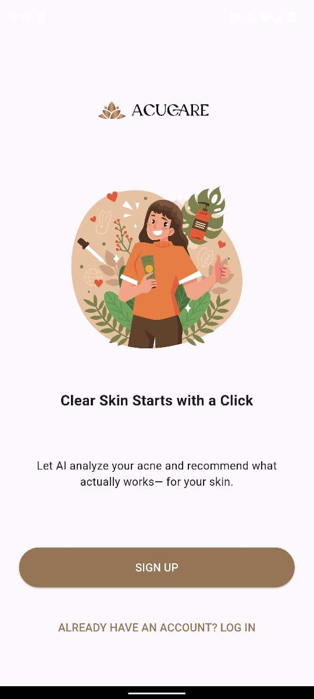
  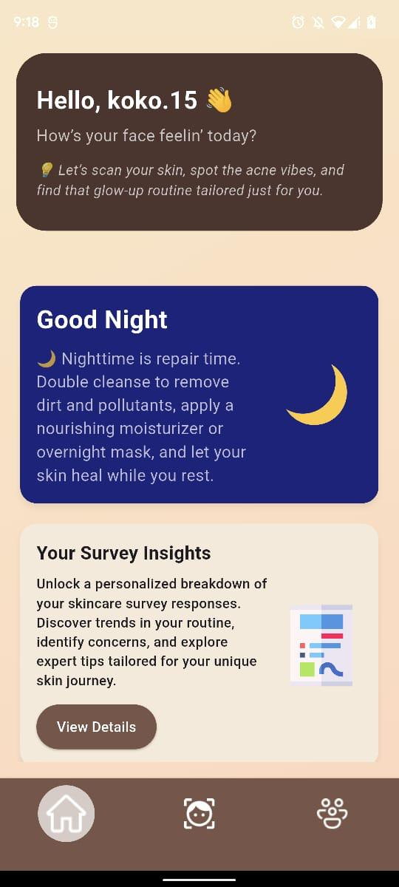
  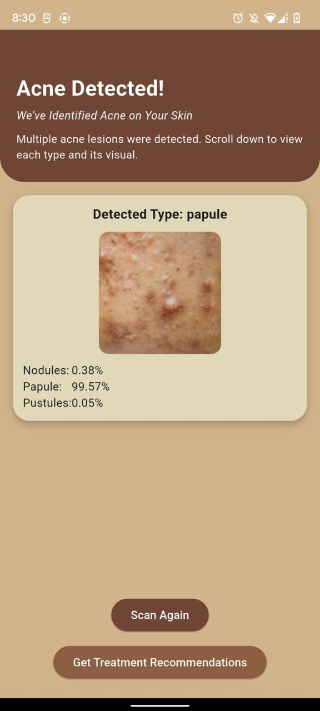
  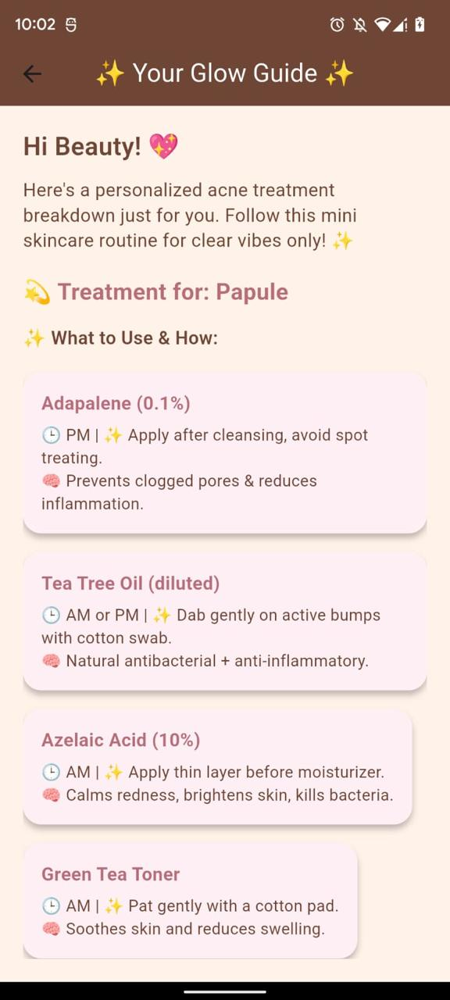
  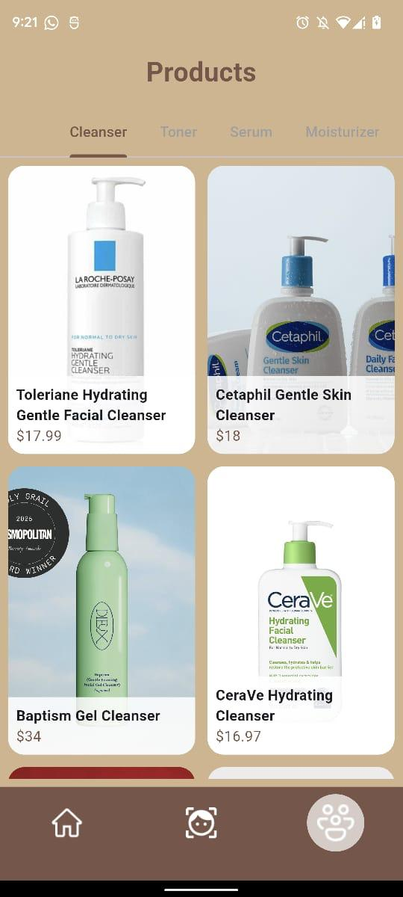
</p>

<p align="center">
  <a href="https://github.com/user-attachments/assets/738d2a02-3aee-43f0-9dff-531080ace201">
    <b>▶ Watch the AcuCare Demo Video</b>
  </a>
</p>


> **Research prototype.** AcuCare is not a medical device and must not be used for diagnosis or treatment decisions. See the [disclaimer](#disclaimer).

---

## Table of contents

- [Overview](#overview)
- [What's in this repository](#whats-in-this-repository)
- [System architecture](#system-architecture)
- [The mobile app](#the-mobile-app)
- [The ML pipeline](#the-ml-pipeline)
- [Dataset](#dataset)
- [Results](#results)
- [Backend API](#backend-api)
- [Repository structure](#repository-structure)
- [Getting started](#getting-started)
- [Limitations and future work](#limitations-and-future-work)
- [Academic context](#academic-context)
- [Disclaimer](#disclaimer)
- [Authors](#authors)
- [Acknowledgements](#acknowledgements)
- [License](#license)

## Overview

Acne is extremely common, affecting up to about 85% of people aged 12 to 24,
yet choosing the right care usually means guesswork. Different lesion types
call for different treatment: a pustule, a papule, and a nodule are not managed
the same way, and access to a dermatologist is limited in many places.

AcuCare turns a phone photo into a structured answer in three steps:

1. **Detect** where the acne is on the face.
2. **Classify** the lesion as a **nodule**, **papule**, or **pustule**.
3. **Recommend** a skincare routine and matching products for that lesion type.

The project deliberately uses **interpretable, hand-crafted features** (texture,
shape, edges, and Gabor responses) with lightweight classifiers instead of an
end-to-end neural network. With a dataset of only 184 images, this keeps the
system fast enough for a phone, makes it possible to compare segmentation methods
and classifiers in a controlled way, and lets us see what each model is looking at.

## What's in this repository

AcuCare has several parts. This repository holds the ones marked **Included**,
and documents the rest through screenshots and a demo video.

| Component | Status | Location |
|---|---|---|
| Segmentation (K-Means and Fuzzy C-Means) | Included | `ml-backend/seg_kmeans.py`, `seg_fcm.py` |
| Feature extraction | Included | `ml-backend/feat_k.py`, `feat_f.py` |
| Classifiers: ELM, Ensemble ELM, SVM, KNN, Random Forest, LightGBM | Included | `ml-backend/elm.py`, `svm.py`, ... |
| Trained models and extracted features | Included | `ml-backend/*.joblib`, `*.npz` |
| Evaluation reports, confusion matrices, ROC curves | Included | `ml-backend/results*/` |
| Flask API and browser test page | Included | `ml-backend/app.py`, `templates/` |
| Acne image dataset (184 images) | Included | `ml-backend/compiled/` |
| Demo video and app screenshots | Included | `docs/` |
| Flutter mobile app | Shown in demo | Source code to be added |
| YOLOv8 acne detection (Roboflow API) | Used by the app | Hosted on Roboflow, called from the mobile app |
| Rule-based treatment recommender | Used by the app | Part of the mobile app |

## System architecture

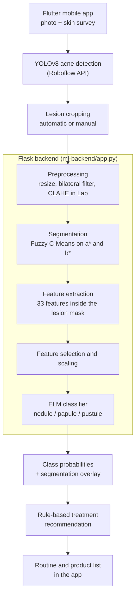

The Flask service in this repository implements the "Flask backend" box. It takes a
cropped lesion image and returns class probabilities with a segmentation overlay.

## The mobile app

The app is built with Flutter and talks to the Flask backend. Sign-in and cloud
storage use Firebase (Authentication and Firestore). Screenshots are from the demo build.

### Onboarding and sign-in

<p>
  
  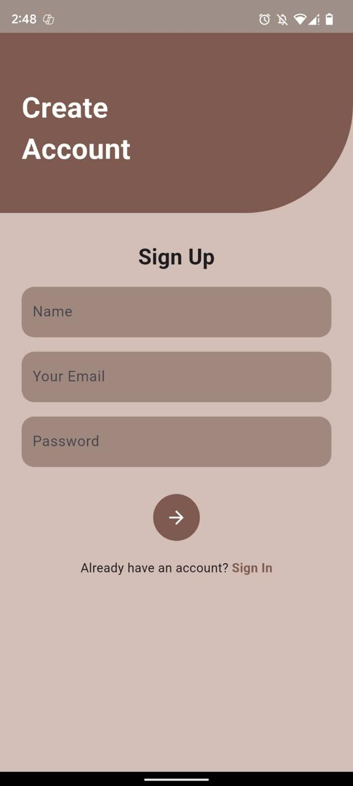
  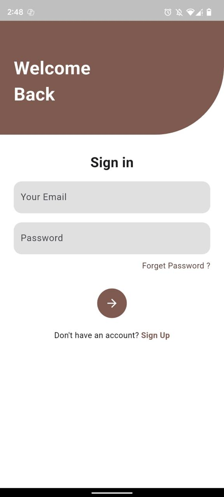
</p>

New users create an account or sign in with email and password.

### Skin survey

<p>
  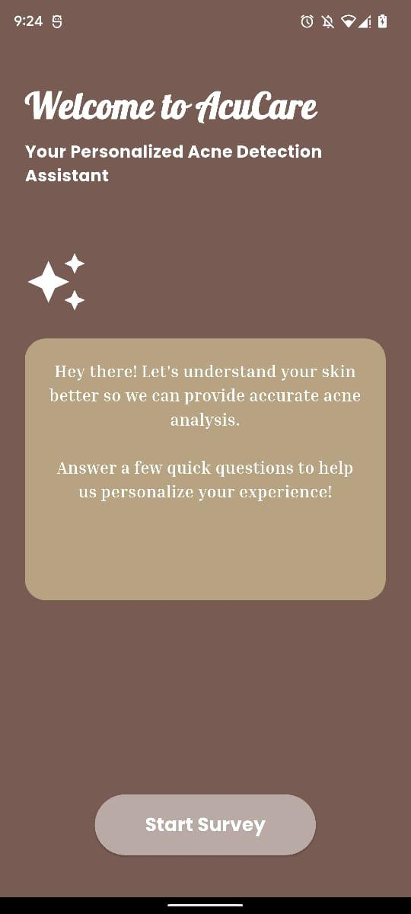
  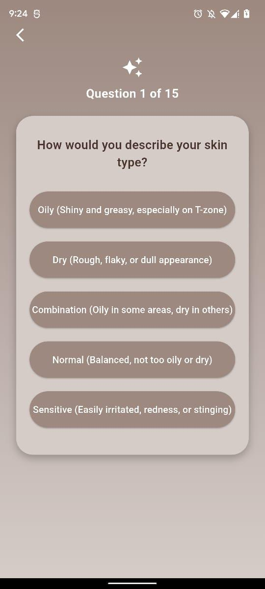
  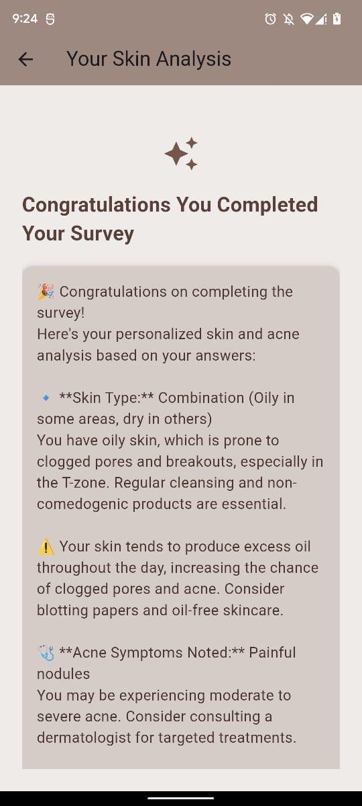
</p>

A 15-question survey covers skin type and acne symptoms. At the end, the app
produces a written analysis, for example a combination skin type that tends to
be oily in the T-zone, with tailored advice.

### Scan, detect, and treat

<p>
  
  
  
</p>

- **Home:** a dashboard with a greeting, time-of-day skincare tips, and survey insights.
- **Scan result:** the detected lesion crop with a probability for each type (nodule, papule, pustule) and the top prediction.
- **Treatment guide:** a step-by-step routine for the detected type, with when and how to apply each ingredient. For papules this includes adapalene, diluted tea tree oil, azelaic acid, and a green tea toner.

### Products

<p>
  
  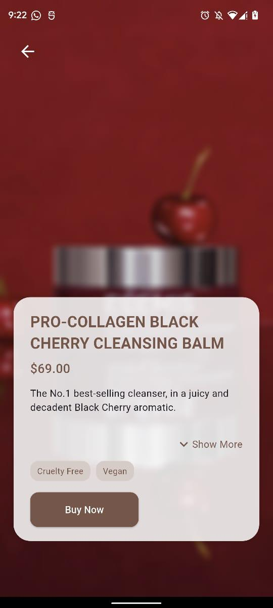
</p>

A product catalogue organised by category (cleanser, toner, serum, moisturiser), with detail pages for each item.

## The ML pipeline

### 1. Preprocessing

1. Resize the lesion crop to 150 x 150 pixels.
2. Denoise with a bilateral filter, which smooths skin texture while keeping edges.
3. Convert to the **Lab** colour space and apply **CLAHE** to the lightness channel to even out lighting.

### 2. Segmentation

Two unsupervised methods were built and compared:

| Method | How it works |
|---|---|
| **K-Means** | Hard clustering of pixels in Lab colour space |
| **Fuzzy C-Means (FCM)** | Soft clustering (3 clusters, fuzziness 2.0) on the `a*` and `b*` channels. The cluster with the highest mean `a*` (the reddest) is taken as the lesion |

Both pipelines then clean the mask with morphological opening and closing,
add bright high-`b*` pixels to capture pus, remove objects smaller than 200
pixels, and fill holes.

<p align="center">
  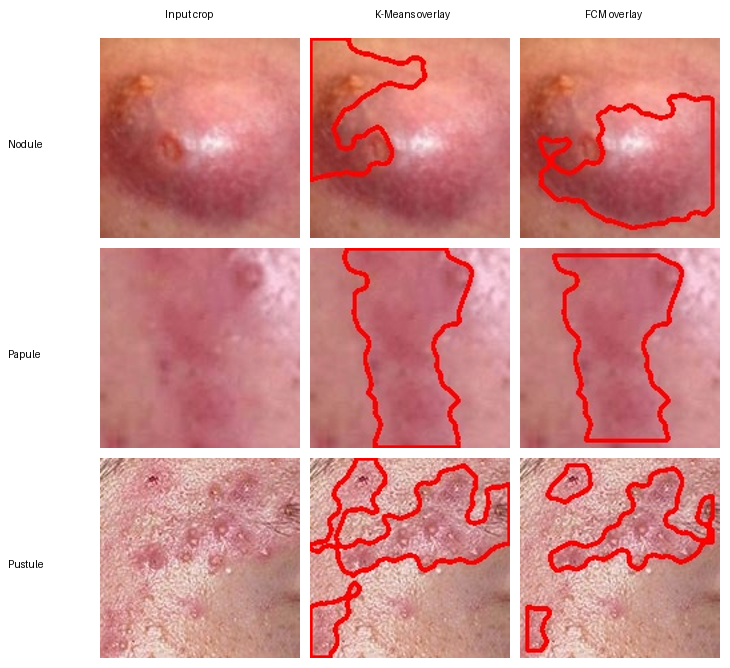
</p>
<p align="center"><i>Example segmentation outputs. The red outline marks the region each method treats as lesion.</i></p>

### 3. Feature extraction

The code in this repository, and the deployed backend, computes **33 features**
inside the lesion mask:

| Group | Features | Count |
|---|---|---|
| Texture (GLCM) | Contrast, correlation, energy, homogeneity, averaged over 4 angles | 4 |
| Intensity | Mean and standard deviation of grayscale values | 2 |
| Shape | Area, perimeter, circularity, solidity, eccentricity, extent, major axis, minor axis, aspect ratio | 9 |
| Edges | Canny edge density | 1 |
| Local texture (LBP) | Variance of uniform local binary patterns | 1 |
| Gabor filters | Mean and standard deviation over 4 orientations and 2 scales | 16 |

> **Note on the thesis.** The thesis describes a richer 49-feature vector that also includes colour statistics (RGB, HSV, YCbCr) and per-angle GLCM values. The 33-feature version above is what ships in this repository's code and feature files.

A reduced set of the **10** most informative features, chosen with ANOVA
F-score selection (`SelectKBest`) on the training set only, is also produced to test
whether fewer features generalise better on a small dataset.

### 4. Classification

| Model | Notes |
|---|---|
| **Extreme Learning Machine (ELM)** | The primary model. A single hidden layer with random weights, where the output weights are solved in closed form with ridge regularisation. No backpropagation, so training is very fast. Hidden neurons, activation, regularisation `C`, and the number of selected features are tuned by grid search |
| **Ensemble ELM** | 15 ELMs trained with different random seeds, with their predicted class probabilities averaged to reduce the variance of random initialisation |
| **SVM** | RBF kernel, with `C`, `gamma`, and the number of features tuned by grid search and 10-fold cross-validation |
| **Random Forest** | 100 trees, maximum depth 10 |
| **KNN** | Euclidean distance, `k = 7`, 20 selected features |
| **LightGBM** | Shallow trees with L1 and L2 regularisation, top 30 features |

Every model was trained and evaluated on features from both segmentation methods.

## Dataset

A curated set of **184 facial acne images**, collected from public sources
(including Skin90, DermNet, and other online dermatology repositories) and
manually cropped to **150 x 150 pixels**, centred on the lesion.

| Class | Images |
|---|---|
| Nodules | 51 |
| Papules | 61 |
| Pustules | 72 |
| **Total** | **184** |

- **Split:** 70% train (127 images) and 30% test (57 images), stratified by class, with a fixed random seed.
- **Test set:** 16 nodules, 19 papules, 22 pustules.
- **No data augmentation** was applied, to keep the natural variation in lighting, skin tone, and lesion appearance.

The images are in [`ml-backend/compiled/`](ml-backend/compiled/), one folder per
class. The segmentation scripts create the train/test split from them
automatically.

> **Image licensing.** The images come from public sources and remain the property of their original owners and subject to those sources' terms. They are included for research and reproducibility. If you reuse them, check the terms of each source, especially for commercial use.

> **Small dataset.** With 57 test images, one extra correct prediction moves accuracy by about 1.8 points, so differences of a point or two between models are not meaningful.

## Results

All models were trained on the same 70/30 split and evaluated on the 57-image test set.

### FCM segmentation

| Classifier | Test accuracy | Nodule recall | Papule recall | Pustule recall |
|---|---|---|---|---|
| **SVM** | **88.00%** | 81.00% | 84.00% | 95.00% |
| Random Forest | 86.00% | 81.00% | 79.00% | 95.00% |
| ELM | 85.96% | 62.50% | 94.74% | 95.45% |
| Ensemble ELM | 85.96% | 62.50% | 94.74% | 95.45% |
| KNN | 84.00% | 81.00% | 79.00% | 91.00% |
| LightGBM | 74.00% | 44.00% | 68.00% | 100.00% |

### K-Means segmentation

| Classifier | Test accuracy | Nodule recall | Papule recall | Pustule recall |
|---|---|---|---|---|
| **ELM** | **84.21%** | 62.50% | 89.47% | 95.45% |
| Ensemble ELM | 82.46% | 62.50% | 89.47% | 95.45% |
| KNN | 81.00% | 62.00% | 79.00% | 95.00% |
| Random Forest | 79.00% | 56.00% | 79.00% | 95.00% |
| SVM | 77.00% | 62.00% | 74.00% | 91.00% |
| LightGBM | 68.00% | 44.00% | 53.00% | 100.00% |

### Main findings

- **Best accuracy: 88%**, from an SVM on FCM-segmented features.
- **FCM beat K-Means for every classifier**, by the largest margins for SVM (+11 points) and Random Forest (+7). Soft cluster membership handles the blurry boundary between red lesions and surrounding skin better than hard assignment.
- **ELM was the most robust to segmentation quality.** It kept 84.21% even with K-Means masks, where other models dropped, and trains in a fraction of the time of the others. This is why it powers the app's backend.
- **Pustules and papules were classified reliably.** Pustule recall was 91% or higher for every model.
- **Nodules were the hardest class** for every model, with recall between 44% and 81%. This is consistent with them having the fewest examples (51) and looking similar to papules.
- **LightGBM performed worst**, which suggests gradient boosting is a poor fit for a dataset this small.

### Confusion matrix and ROC curves (ELM, FCM)

<p>
  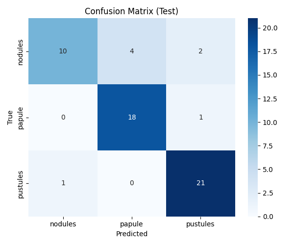
  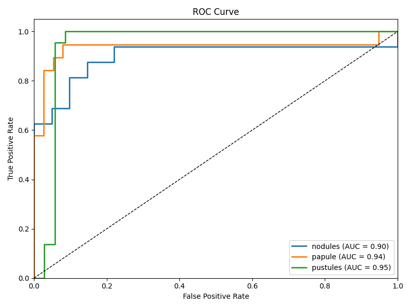
</p>

For ELM with FCM, per-class counts on the test set were:

| | Nodules | Papules | Pustules |
|---|---|---|---|
| True positives | 10 | 18 | 21 |
| False positives | 1 | 4 | 3 |
| False negatives | 6 | 1 | 1 |

All other confusion matrices, ROC curves, and per-class precision, recall, and F1
reports are in `ml-backend/results/`, `results_svm/`, `results_knn/`,
`results_rf/`, and `results_lgbm/`, including extra runs with the reduced 10-feature set.

## Backend API

The Flask app loads the trained ELM pipeline (`elm_fmeans.joblib`) and serves a
small API and test page.

| Method | Route | Description |
|---|---|---|
| `GET` | `/` | Browser test page. Upload an image, move a 150 x 150 crop box over a lesion, and classify it |
| `POST` | `/predict` | Classify an image |

**`POST /predict`** takes a multipart form with an `image` file and returns:

```json
{
  "nodules": 0.38,
  "papule": 99.57,
  "pustules": 0.05,
  "top": "papule",
  "features": [ ... 33 values ... ],
  "overlay": "data:image/png;base64,..."
}
```

Probabilities are percentages. `overlay` is the input image with the detected
lesion outlined in red.

Example request:

```bash
curl -X POST -F "image=@lesion.jpg" http://127.0.0.1:5000/predict
```

## Repository structure

```
AcuCare/
├── README.md
├── LICENSE
├── requirements.txt
├── docs/
│   ├── demo/acucare_video_demo.mp4     # app walkthrough
│   ├── screenshots/                    # app screenshots (acucare-1 to 11)
│   └── pipeline_examples.png           # segmentation examples
└── ml-backend/
    ├── app.py                          # Flask API
    ├── templates/index.html            # browser test page
    ├── seg_kmeans.py, seg_fcm.py       # segmentation (K-Means, FCM)
    ├── feat_k.py, feat_f.py            # feature extraction
    ├── reduce_features.py              # ANOVA top-10 feature selection
    ├── elm.py, elm_f.py                # ELM and Ensemble ELM (K-Means, FCM)
    ├── svm.py, knn.py, rf.py, lgb.py   # other classifiers
    ├── *.joblib                        # trained models
    ├── *.npz                           # extracted features (train/test)
    ├── results/                        # ELM reports and plots
    ├── results_svm/, results_knn/, results_rf/, results_lgbm/
    └── compiled/                       # dataset: nodules/, papule/, pustules/
```

## Getting started

### Prerequisites

- Python 3.9 or newer

### Install

```bash
git clone https://github.com/<your-username>/AcuCare.git
cd AcuCare
python -m venv .venv
source .venv/bin/activate        # Windows: .venv\Scripts\activate
pip install -r requirements.txt
```

### Run the backend

```bash
cd ml-backend
python app.py
```

Open <http://127.0.0.1:5000>, upload a photo, position the crop box over a
lesion, and run the classifier.

> The `.joblib` files were saved with a particular scikit-learn version. If loading fails with a version error, install the version that created them, or retrain with `elm_f.py`.

### Reproduce the experiments

Run these from inside `ml-backend/`.

| Step | Command |
|---|---|
| Segment images and create the train/test split | `python seg_kmeans.py` and `python seg_fcm.py` |
| Extract features | `python feat_k.py` and `python feat_f.py` |
| Reduce to 10 features | `python reduce_features.py` |
| Train and evaluate | `python elm_f.py`, `elm.py`, `svm.py`, `knn.py`, `rf.py`, `lgb.py` |

Reports and plots are written to the `results*` folders. The `.npz` files already
contain the extracted features, so you can skip straight to the training step.

> `feat_k.py` and `feat_f.py` contain an absolute Windows path for the input folder. Edit the `input_root` line to point to your own segmentation output before running them.

## Limitations and future work

**Current limitations**

- **Small dataset:** 184 images with slight class imbalance and no augmentation, which limits generalisation across populations and skin tones.
- **Single test split:** results come from one 70/30 split, so there are no confidence intervals.
- **K-Means is sensitive to conditions:** low contrast and uneven lighting reduce segmentation and feature quality.
- **Lesion type only:** the system does not grade acne severity, which clinical assessment needs.
- **Not clinically validated:** the app has not had clinical validation or large-scale user trials.

**Future work**

- [ ] Larger, more diverse, and better balanced datasets, especially more nodules and a wider range of skin tones
- [ ] Automated severity grading (mild, moderate, severe) for more tailored recommendations
- [ ] Hybrid segmentation, such as FCM with metaheuristic optimisation (Moth Flame or Particle Swarm Optimisation), or lightweight deep-learning segmentation
- [ ] Clinical validation with dermatologists and controlled user studies
- [ ] Interpretability tools such as heatmaps or text explanations for predictions
- [ ] Reliability-aware evaluation of segmentation, and robustness testing under domain shift
- [ ] Publish the Flutter app source

## Academic context

AcuCare was developed as a final year project:

> **AcuCare: Integrating Image Processing and Feature-Based Learning into a Mobile App for Acne Detection and Classification**
> Department of Electrical Engineering & Computer Science, Institute of Space Technology, July 2025

**Supervisors:** Mr. Tufail Shah and Ms. Ifrah Mansoor

## Disclaimer

AcuCare is a research prototype built for educational purposes. It is **not a
medical device**, has not been clinically validated, and does not provide
medical advice. Do not use it to diagnose a condition or choose a treatment.
Product and ingredient suggestions are general information only. If you have
painful, severe, or persistent acne, see a dermatologist or other qualified
healthcare professional.

## Authors

- **Humna Ali**
- **Zuha Fatima**

Contact: humna.zaidi17@gmail.com

## Acknowledgements

- Our supervisors, Mr. Tufail Shah and Ms. Ifrah Mansoor, for their guidance.
- The public dermatology image sources used for the dataset, including Skin90 and DermNet.
- [Roboflow](https://roboflow.com/) for hosting the YOLOv8 detection model.
- The open-source projects this work builds on: NumPy, SciPy, OpenCV, scikit-learn, scikit-image, scikit-fuzzy, LightGBM, Flask, and Flutter.

## License

The code is released under the [MIT License](LICENSE). The dataset images are
not covered by this license; see [Dataset](#dataset).
